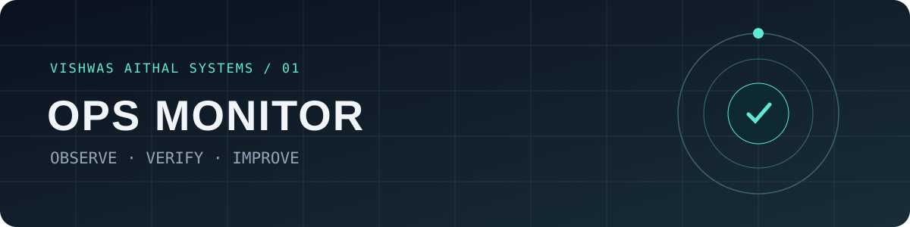
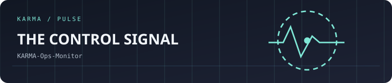
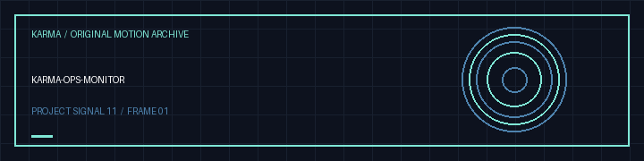

<!-- VISHWAS.EXE UNIFIED THEME START -->

<strong>VISHWAS.EXE / Ops Monitor</strong> Public metadata, monitoring design and engineering operations Designed and built by <strong>Vishwas Aithal</strong> · Same computer universe, its own personality

  <a href="https://vishwasaithalz.github.io/vishwasaithalz/"><strong>💾 BOOT MANAGER</strong></a> &nbsp;·&nbsp;
  <a href="https://vishwasaithalz.github.io/vishwasaithalz/overload/"><strong>🖥️ OVERLOAD OS</strong></a> &nbsp;·&nbsp;
  <a href="https://vishwasaithalz.github.io/vishwasaithalz/arcade/"><strong>🎮 ARCADE</strong></a> &nbsp;·&nbsp;
  <a href="https://github.com/vishwasaithalz?tab=repositories"><strong>📁 ALL PROJECTS</strong></a> &nbsp;·&nbsp;
  <a href="https://vishwasaithal.ai.studio/"><strong>🌐 PORTFOLIO</strong></a>

<!-- VISHWAS.EXE UNIFIED THEME END -->

<strong>🎞 Open legacy project visuals and original navigation</strong>

<strong>🛰️ Vishwas Aithal Ops Monitor</strong> · Portfolio operations and engineering

# ◈ Vishwas Aithal / OPS MONITOR

**The signal tower for a growing developer ecosystem.**

`OBSERVE  /  VERIFY  /  DOCUMENT  /  IMPROVE`

---

## Mission control

A starter for **verified** GitHub CI signals, planned Vercel deployment checks, public SEO checks and release-readiness notes. A scheduled GitHub Actions workflow refreshes `public-status.json` from public CI run metadata; this is **not** a production uptime monitor or proof that live application routes work.

| Signal | What will be checked | Status |
|:--|:--|:--|
| 🛰️ Deployments | Linked production deployment state | Planned |
| 🧪 CI | Public GitHub Actions run metadata in `public-status.json` | Scheduled snapshot; not full test coverage |
| 🔎 SEO | Public metadata, robots and sitemaps | Planned |
| 🔐 Privacy | No credentials or private site content in reports | Policy |
| 📓 Journal | Verified changes with timestamps | Planned |

## Interface direction

- **Graphite and teal** visual system, restrained highlights and clean typography.
- **Animated SVG** status indicators only when backed by real data.
- **Accessible dark/light** layouts, responsive dashboards and reduced-motion support.
- **Interactive filters** for projects, severity and environment in a future deployed UI.
- **No fake uptime, passing badges, charts or deployment claims.**

## Safe operating rules

1. Read-only checks first; do not change DNS, secrets, billing or visibility.
2. Only monitor explicitly approved projects and public endpoints.
3. Keep private deployment authentication intact.
4. Test reversible changes before merging or deploying.
5. Record exact source SHA, timestamp and verification evidence.
6. Never report a site as healthy solely because a deployment is marked READY.

## Roadmap

- [x] Establish repository design and operating policy
- [ ] Add typed project inventory with explicit allowlists
- [ ] Implement tested, read-only CI and deployment adapters
- [ ] Create accessible dashboard with verified source data
- [ ] Add optional manual workflow and failure isolation
- [ ] Integrate with Vishwas Aithal Control Center after canonical source verification

---

Built for evidence, not vanity metrics. · Vishwas Aithal SYSTEMS

<strong>Visual gallery and interactive Vishwas Aithal homepage</strong>

<a href="https://karma-ops-monitor.vercel.app">Open the interactive project gallery with original user-controlled sound</a>.

<!-- KARMA AVATAR GALLERY -->

<a href="https://karma-ops-monitor.vercel.app/#gallery">Explore the animated project gallery</a>

### Original motion gallery

[Download this project's GIF](assets/karma-motion.gif) · [View the animated SVG](assets/karma-signal.svg)
